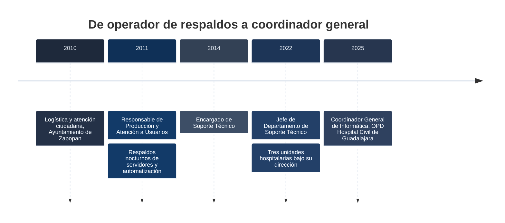
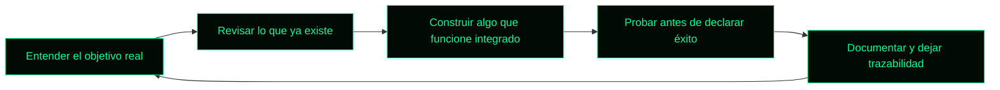

<div align="center">


</div>

```text
$ whoami
roberto_carlos_vazquez

$ cat sobre_mi.txt
Más de 15 años haciendo que la tecnología funcione donde más importa: un hospital.
Empecé en roles operativos y escalé dentro de la misma institución hasta coordinarla.
Me gusta lo que se puede demostrar, mantener y heredar. Lo demás es PowerPoint.
```

## 🧭 Trayectoria



| Periodo | Rol |
|---|---|
| 2025 a la fecha | **Coordinador General de Informática**, OPD Hospital Civil de Guadalajara |
| 2022 a 2025 | Jefe de Departamento de Soporte Técnico, Unidad Hospitalaria Dr. Juan I. Menchaca |
| 2014 a 2022 | Encargado de Soporte Técnico, misma unidad |
| 2011 a 2014 | Responsable de Producción y Atención a Usuarios, misma unidad |

## 📟 Estadísticas del sistema

| Métrica | Valor |
|---|---|
| ⏱️ Uptime profesional | 15+ años en el sector salud |
| 🏥 Unidades hospitalarias bajo soporte | 3 |
| 🌐 Mejora en la funcionalidad de la red institucional | 400% |
| 💻 Renovación del parque de cómputo | 70% |
| 🕒 Operación de los sistemas | 24/7 |
| 🧬 Origen | Operación, no escritorio |

## 🏆 Misiones cumplidas

- 🌐 **Red:** renovación integral de la infraestructura, con una mejora de 400% en su funcionalidad.
- 💻 **Cómputo:** renovación del 70% del equipamiento institucional.
- 🏥 **Soporte:** dirección del soporte técnico en tres unidades hospitalarias con un equipo de alto rendimiento.
- 🎓 **Congreso:** líder de proyecto de la plataforma del Congreso Internacional Avances en Medicina (CIAM).
- 🤖 **IA con orden:** impulso de modernización y automatización de procesos clínicos y administrativos, y de
  una práctica de uso de IA con registro y responsabilidad humana.

## 🛠️ Arsenal


```text
infraestructura   : redes, virtualización, seguridad perimetral, respaldos
datos             : SQL Server, dashboards ejecutivos con cifras fieles a la fuente
desarrollo        : APIs, módulos web, plantillas compartidas para las áreas
inteligencia      : IA local, agentes, y equipos humano más IA con trazabilidad
```

## 🧠 Cómo trabajo



- **Liderazgo estratégico** y dirección de equipos multidisciplinarios.
- **Transformación digital** y optimización de procesos.
- **Gestión de proyectos de TI** y gestión del cambio.
- **Decisiones con datos**, sin inventar cifras.
- **Humano al mando.** La IA acelera; la responsabilidad no se delega.

## 🎓 Formación

- Maestría en Gestión del Talento Humano, Universidad Univer (concluida, con certificado)
- Maestría en Gestión de Proyectos, Universidad Univer (titulado)
- Licenciatura en Tecnologías de la Información, Universidad de Guadalajara (titulado, 2022)
- Técnico Profesional en Informática, Universidad de Guadalajara (2009)

## 🏛️ Mi organización en GitHub

Con mi equipo construimos módulos sobre una base común y con IA con registro en
[DesarrollosHCG](https://github.com/DesarrollosHCG).

---

<div align="center">

```text
$ echo "Tecnología que se nota, decisiones trazables y responsabilidad humana en cada entrega."
```

</div>
