## 👋 Hola, soy Carlos

Amante de las Tecnologías de la Información, con más de 15 años de experiencia gestionando y optimizando
herramientas tecnológicas en el sector salud. Hoy coordino la informática de un organismo hospitalario
público en Guadalajara, con unidades que operan las 24 horas.

Empecé en roles operativos y fui creciendo dentro de la misma institución hasta posiciones de liderazgo.
Me gusta que la tecnología se note: que el sistema funcione, que se pueda demostrar y que alguien más lo
pueda mantener después.

## 🧭 Trayectoria

| Periodo | Rol |
|---|---|
| 2025 a la fecha | **Coordinador General de Informática**, OPD Hospital Civil de Guadalajara |
| 2022 a 2025 | Jefe de Departamento de Soporte Técnico, Unidad Hospitalaria Dr. Juan I. Menchaca |
| 2014 a 2022 | Encargado de Soporte Técnico, misma unidad |
| 2011 a 2014 | Responsable de Producción y Atención a Usuarios, misma unidad |

## 🏆 Algunos resultados

- 🌐 Renovación integral de la infraestructura de red institucional, con una mejora de 400% en su funcionalidad.
- 💻 Renovación del 70% del parque de cómputo institucional.
- 🏥 Dirección del soporte técnico en tres unidades hospitalarias, con un equipo de alto rendimiento.
- 🎓 Líder de proyecto de la plataforma del Congreso Internacional Avances en Medicina (CIAM).
- 🤖 Impulso de modernización y automatización de procesos clínicos y administrativos, y de una práctica
  de uso de IA con registro y responsabilidad humana.

## 🛠️ Con qué trabajo

Infraestructura y redes, APIs, dashboards ejecutivos, IA local y agentes de IA, siempre con datos
institucionales protegidos.

## 🎯 Lo que más me importa

- **Liderazgo estratégico** y dirección de equipos multidisciplinarios.
- **Transformación digital** y optimización de procesos.
- **Gestión de proyectos de TI** y gestión del cambio.
- **Toma de decisiones con datos**, con cifras fieles a la fuente.

## 🎓 Formación

- Maestría en Gestión del Talento Humano, Universidad Univer (concluida, con certificado)
- Maestría en Gestión de Proyectos, Universidad Univer (titulado)
- Licenciatura en Tecnologías de la Información, Universidad de Guadalajara (titulado, 2022)
- Técnico Profesional en Informática, Universidad de Guadalajara (2009)

## 🏛️ Mi organización en GitHub

Con mi equipo construimos módulos sobre una base común y con IA con registro en
[DesarrollosHCG](https://github.com/DesarrollosHCG).

---

*Tecnología que se nota, decisiones trazables y responsabilidad humana en cada entrega.*

